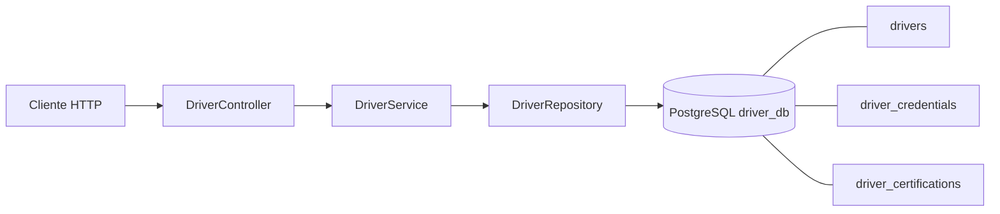
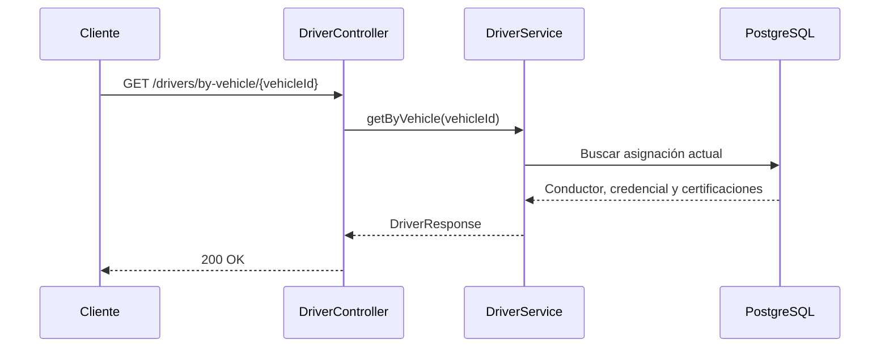

# Arquitectura de driver-service

## Componentes

## Consulta de asignación

La asignación actual pertenece al conductor. La entidad de conductor mantiene únicos `assignment_id` y `vehicle_id`; la API exige que ambos aparezcan juntos.
